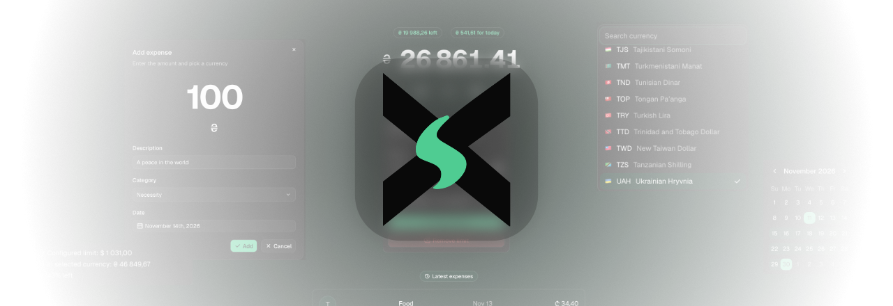

<p align="center">
    <picture>
      
  </picture>
</p>
<h1 align="center">
  <span>Xpensy</span>
</h1>
<p align="center">
  <span align="center">Xpensy (sounds almost like "expensive" 🤔) is a multicurrency expense tracker for however you spend. Log an expense in whatever currency you actually paid — an online subscription, a trip abroad, or an everyday purchase at home — and Xpensy converts it all into the currency you think in, so your totals, categories, and spending limits always add up.</span>
</p>
<p align="center">
  <a href="https://nextjs.org">
    
  </a>
  <a href="https://www.typescriptlang.org">
    
  </a>
  <a href="https://tailwindcss.com">
    
  </a>
  <a href="https://supabase.com">
    
  </a>
</p>

<h3 align="center">
  <a href="#why">Why?</a> 
    <span> · </span>
  <a href="#usage">Usage</a>
  <span> · </span>
  <a href="#installation">Installation</a> 
  <span> · </span>
  <a href="#roadmap">Roadmap</a>
</h3>

<br/><br/>

<p align="center">
    <picture>
      
  </picture>
</p>
<p align="center">
    <sub>⚠️ This project is actively in development</sub>
</p>

<br/><br/>

## Why?

I've been using a lot of different expense trackers (including Excel spreadsheets 🥹), and most of them have their own flaws like a single currency, or lacking a way to share tracking with someone else in real time. If you pay for subscriptions in US dollars (USD), spend euros (EUR) while traveling, or receive your salary in Ukrainian hryvnias (UAH), the final totals simply stop adding up. Xpensy keeps every expense in its original currency and converts it to the one you think in, so you always see one accurate number.

Sharing makes it harder. When you and the person you track expenses with live in different countries or just far apart — every shared bill crosses a currency, and someone ends up rebuilding the spreadsheet. That's why I decided to create Xpensy. I want to keep those expenses in one shared view, in the currency each of you understands.

## Usage

1. Create an account and choose the currency you want to see totals in (you can configure this anytime).
2. Add an expense with its amount, description, category, currency, and date.
3. Watch the dashboard total update in your preferred currency, whichever currency you paid in.
4. Set a spending limit for a period to see what's left and how much is safe to spend per day.
5. Review your recent expenses grouped by date.

⚠️ Shared collections — tracking expenses together with someone else, with real-time sync & other roadmap features — are in development.

## Installation

Want to run it locally or host by yourself?

### Prerequisites

- Node.js 20+
- pnpm 11 (the repo enforces it via `only-allow`)
- A Supabase project

### Setup

```bash
pnpm install
cp .env.example .env
```

Add your Supabase credentials to `.env`:

| Variable                               | Description                 |
| -------------------------------------- | --------------------------- |
| `NEXT_PUBLIC_SUPABASE_URL`             | Your Supabase project URL   |
| `NEXT_PUBLIC_SUPABASE_PUBLISHABLE_KEY` | Your publishable (anon) key |

Apply the database schema and RLS policies in [`docs/info/Xpensy-Database-Schema.md`](./docs/info/Xpensy-Database-Schema.md) before running the app.

Start the dev server:

```bash
pnpm dev
```

Then open [http://localhost:3000](http://localhost:3000).

### Scripts

| Command         | Description                         |
| --------------- | ----------------------------------- |
| `pnpm dev`      | Dev server with webpack             |
| `pnpm dev:fast` | Dev server with the default bundler |
| `pnpm build`    | Production build                    |
| `pnpm start`    | Serve the production build          |
| `pnpm lint`     | Run ESLint                          |
| `pnpm test`     | Run the Vitest suite                |
| `pnpm prettier` | Format with Prettier                |

## Roadmap

Live status: [Xpensy project board](https://github.com/users/TSlashDreamy/projects/3/views/1)

### Shipped

- Email/password authentication, password reset, and preferred currency
- Personal expense tracking with categories, dates, and descriptions
- Multicurrency totals using live exchange rates
- Spending limits with remaining budget and daily-safe-spend stats
- Light and dark themes

### In progress

- Hide expenses toggle (privacy mode)

### Planned

- Shared collections with invites and real-time sync
- Collection switcher and a dedicated collections page
- Connections: managing the people you share expenses with
- Dashboard charts: pie, radar, and horizontal/interactive bar
- Additional dashboard statistics
- Settings and account pages
- Self-hosting support: Docker image and CI/CD pipeline

## License

Released under the [GNU General Public License v3.0](./LICENSE).

<br /><br />
<p align="center">
  <sub>Made with passion by <a href="https://github.com/TSlashDreamy">/TSlash</a></sub>
</p>
